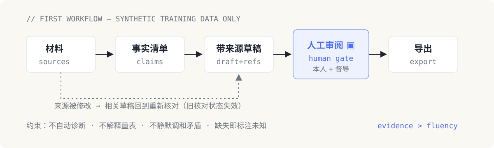

<!-- architect-team:readme-theme=mono -->

<div align="center">
  
</div>

[简体中文](README.zh-CN.md) | **English** | [繁體中文](README.md)

<div id="overview"></div>
<p align="center">
  
</p>

psychtool is a clinical writing workspace that helps individuals write reports; its target user is a clinical trainee without a technical background. It solves the core problem: **how to turn scattered materials into a report draft while preserving who said what, in which setting, when, and with what certainty** — instead of generating fluent prose first and retrofitting citations.

Psychological assessment reports, clinical case reports, progress notes, and academic papers are all in scope long-term; clinical writing comes first. The first validation scenario is deliberately narrower: **organizing synthetic adolescent background material**, with no diagnosis, test interpretation, or treatment decisions. The adolescent and neuropsych emphasis is a design choice; institutional AI policy remains unconfirmed.

<div id="current-state"></div>
<p align="center">
  
</p>

**The core application is implemented and runnable**: the `psychtool` CLI (`init` / `import` / `claims` / `draft` / `review` / `export` / `eval` / `judge` / `dash`) plus a textual dashboard and a colorful startup banner, with **66 automated tests passing**. **A real model is wired in** (linksub `deepseek-v4-pro`, OpenAI-compatible endpoint) and a real `eval` has run: single-step generation is clean (no fabrication, no cross-case leakage, no conflict resolution), while the naive staged baseline was caught by a hard gate leaking a cross-case reference; the desktop/web UI and PDF/OCR import are deferred (ADR 0001, ticket 12).

The repository holds requirements and boundaries, official privacy-source research, empirical evidence matrices, development specs and tickets, two sets of original synthetic training materials, and the runnable CLI application above. Detailed research documents are primarily in Simplified Chinese.

**Browser application (local prototype).** In addition to the CLI, the repository contains a local browser prototype: create a synthetic case, paste synthetic text (rule-based candidate extraction), approve generation requests through the egress gateway, save the output as a section, and find it again after reload. **It uses the offline FakeTransport (`PSYCHTOOL_PROFILE=fake`) by default — no network, no API key.** Vertex AI Gemini is used only when the `vertex` profile is chosen explicitly; the Google AI Studio path is always refused. `http` is for local OpenAI-compatible endpoints. The `real` profile refuses non-local egress, and there is no BAA flag that can enable it. The prototype is **not HIPAA compliant**, as the persistent in-page banner states; use synthetic data only.

Material upload (ADR 0012): M1 accepts only `.txt` / `.md` (UTF-8, up to 10 MiB); scans and images get a fixed explanation (no OCR on the server); before the first upload, each case requires a one-time confirmation that only synthetic or separately approved materials are used. Protected test content blocking (ADR 0013): paragraphs that look like test items, norms or scoring rules are held back before any write (never stored, never sent to the model; the audit log records only a count and a hash; a checker failure rejects the whole upload), with no release path in M1.
Evidence view (ADR 0014): the Evidence panel lists, on demand, full sentences extracted verbatim from the case's materials (with source material, version and paragraph); clicking an item shows the exact location in the source text. This is a checklist for the clinician's review, not a conclusion, and it is never written into the report automatically.
Evidence categories (ADR 0015): each item carries a rule-based suggested category with a one-sentence reason quoting the matched source keyword (provider role recorded separately); evidence is persisted, and her category/role corrections survive rule re-runs via stable location-derived ids — still suggestions for her review, never a verdict.
Dimension mapping (ADR 0016): dimension names come only from the list she uploaded (`kind=dims`); the product has no built-in official list or criteria text. Unsure matches are marked “Needs review” and never a guessed dimension. Every dimension view shows “This is not a diagnosis. The diagnosis is yours.” Her Confirm / Change / “Wrong, no dimension” choices persist on stable ids. Audit rows record only the allowlisted value she picked (a category key, a role key, or a dimension id) — never her text.
Claim sources (ADR 0017): sentence evidence is the only source a claim cites — the `claim_evidence` junction table (schema v7) links each claim to the same-case active evidence rows behind it, with cross-case citation structurally blocked by foreign keys; the v6→v7 migration links existing evidence only and never invents any.
Correction cascade (ADR 0018): when her category or dimension correction actually changes the effective value, citing verified claims return to pending, approved sections citing those claims return to Needs review, and unsent egress requests referencing the evidence are invalidated — all inside one SQLite transaction; saved claim and section text is never rewritten, and sent requests are never touched.
Three-column workspace (ADR 0019): the desktop layout is sections | draft | source card, using the GitBook theme and status shapes from the prototype. The right-column card shows only locations the material really has (never an invented page number); the draft editor stays visible. The prototype export control is not ported. A correction toast always says how many sections were returned to Needs review, including zero.
Section editing (ADR 0020): a generated draft lands unsaved in the editor with its source claims attached; after a successful save, reopening or reloading shows the saved text. Diagnosis, impression and recommendation sections are written only by the clinician: they are never sent to the model and never auto-filled. The draft view has one primary action at a time. The screenshot-diff threshold is 2%.
Sentence citations (ADR 0021): every factual sentence in a draft points at the evidence it used; unsourced sentences are marked Unverified with a wavy underline and can be marked My judgment. A Summary draft that contains diagnostic or recommendation wording is refused, never silently rewritten.

The server/browser path stores cases in a **single SQLite database** (default `local-data/psychtool.db`, overridable via `PSYCHTOOL_DB_PATH`; ADR 0010), with composite primary keys and foreign keys enforcing per-case isolation at the database layer. The ADR 0005 JSON workspaces remain the format for the CLI/evaluation pipeline. Import an existing JSON workspace into the database:

```bash
uv run psychtool import-json fixtures/case_a001   # import the synthetic sample case (--db selects the database path)
```

```bash
cd web && bun install && bun run build   # build the frontend (FastAPI serves web/dist)
cd .. && uv run psychtool-server         # open http://127.0.0.1:8000
```

**Starting without the command line (ADR 0023).** After the deployer has installed a checkout with `uv` or a `.venv`, a non-technical user can double-click `launchers/Start Psychtool.command` (macOS) or `launchers/Start Psychtool.cmd` (Windows). The shortcut starts the local server and opens the browser. If the writing workspace is not running, the page explains that she should double-click Start Psychtool and reload, or ask the person who installed it. If the computer is offline, or a section cannot be saved, the page uses the fixed Q5 wording (see ADR 0023). This has been script-tested on Linux; a real Finder/Explorer double-click, macOS Gatekeeper, and Windows SmartScreen have not been verified.

**Local security baseline (ADR 0011).** The server binds to loopback only (a non-loopback `PSYCHTOOL_HOST` refuses to start); every start mints a session token that all `/api/*` routes (except `GET /api/health`) require via `X-Psychtool-Token`; every response carries a strict CSP and hardening headers; startup self-checks refuse a database inside a cloud-sync folder (disk encryption warns only). The audit trail is an append-only, hash-chained `audit_log` table inside SQLite, written in the same transaction as the state change. **Dev note**: pages served by the server itself carry the token automatically; when using the Vite dev server, set the same `PSYCHTOOL_SESSION_TOKEN` (≥32 chars) for both the backend and the frontend proxy, or the API answers 401.

Tests:

```bash
uv run --extra dev pytest -q                          # backend (incl. test_security / test_selfcheck / test_audit_log / test_send_lock_recovery)
cd web && bun test && bun run build                   # frontend unit tests (incl. api.ts token, send_interrupted state) + build
cd web && bunx playwright install chromium && bun run e2e   # end-to-end (incl. security.e2e: CSP headers, no CSP console errors, tokenless 401)
```

<div id="first-workflow"></div>
<p align="center">
  
</p>

Implemented (CLI command surface):

<div align="center">
  
</div>

<div id="evidence"></div>
<p align="center">
  
</p>

- **OpenAlex retrieval.** Four query passes returned **35 deduplicated candidate records**; caveats in [references/empirical-research.md](references/empirical-research.md).
- **Reviewed studies.** **9 studies** received substantive review (4 on child/adolescent assessment, 5 on AI clinical documentation). One study observed that an extract-facts-then-generate configuration *increased* major errors — so this project **does not assume multi-step is safer** and will compare single-step vs staged generation. Details and access boundaries: [references/empirical-research.md](references/empirical-research.md).
- **Synthetic training cases.** [fixtures/adolescent-background.json](fixtures/adolescent-background.json) contains **2 original synthetic cases** with paragraph-level source locators for traceability and case-isolation checks.
- **Source-fidelity variants.** [fixtures/source-fidelity-variants.json](fixtures/source-fidelity-variants.json) holds **3 paired variants** (missing-vs-negation, third-person attribution, concision–omission) with expected behavior.

The literature informs design judgments; it does not demonstrate that this project reduces errors or saves time. No model output has been evaluated yet.

<div id="reading-order"></div>
<p align="center">
  
</p>

| Step | Document | What it establishes |
|---|---|---|
| 1 | [Clinical requirements and constraints](docs/clinical-requirements.md) | Users, scope, review responsibility, privacy constraints |
| 3 | [Empirical research entry](references/empirical-research.md) | Retrieval coverage, reviewed evidence, access limits |
| 4 | [First workflow spec](docs/first-workflow-spec.md) | End-to-end behavior and acceptance conditions |

More entry points: [HHS source ledger](references/hhs-sources.md) · [Skills and tools register](docs/skills-and-tools.md) · [SPEC 0001](docs/specs/0001-first-workflow-cli.md) · [ADRs](docs/adr/) · [Tickets](.scratch/first-workflow/issues/)

<div id="privacy"></div>
<p align="center">
  
</p>

- All current materials are synthetic, publicly sourced, or developer notes; no real patient data is included.
- Case isolation, logs, temp files, backups, network calls, and exported copies are all **boundaries to implement and verify**.
- Local execution, encryption, or a passing tool check alone does not establish HIPAA compliance. Source review: [references/privacy-research.md](references/privacy-research.md); not legal advice.
- DSM access should go through authorized library entry points; APA and Pearson terms restrict AI use — reading access does not grant app ingestion rights. .

<div id="next-steps"></div>
<p align="center">
  
</p>

1. Run `judge` (per-claim semantic support, separate judge slot) against the real model.
2. Build the student-facing UI (desktop/web, deferred per ADR 0001).
3. PDF/scan import (local Indra OCR, see [references/ocr-tooling.md](references/ocr-tooling.md), ticket 12).
4. Only after evaluation passes, assess whether to adopt Harness² for workflow optimization and whether to ingest licensed reference materials.

<div id="limitations"></div>
<p align="center">
  
</p>

Institutional AI policy, the student's device and preferences remain unknown; evidence review depth was limited by access conditions and no exhaustive errata sweep was performed; no license file is included — **all rights reserved**. Document structure was validated against local rendering only.
