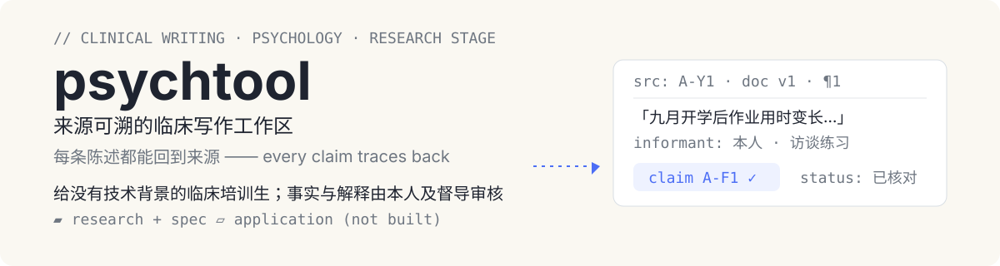
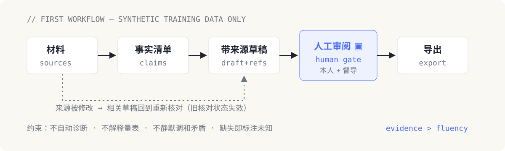

<!-- architect-team:readme-theme=mono -->

<div align="center">
  
</div>

[简体中文](README.zh-CN.md) | [English](README.en.md) | **繁體中文**

<div id="overview"></div>
<p align="center">
  
</p>

psychtool 是一個幫助個人寫報告的臨床寫作工作區，目標使用者是沒有技術背景的臨床培訓生。它解決的核心問題：**如何在把分散資料整理成報告草稿的同時，保留誰在什麼場合、什麼時間、以什麼確定性說了什麼**——而不是先生成流暢文字再回頭補引用。

心理評估報告、臨床個案報告、進展紀錄與學術論文都在長期範圍內；目前優先臨床寫作，首個驗證情境刻意收窄為**整理合成的青少年背景資料**：不做診斷、不解釋量表、不做治療決策。青少年與神經心理側重是設計選擇；機構 AI 政策尚未確認。

<div id="current-state"></div>
<p align="center">
  
</p>

**核心應用程式已實作並可執行**：`psychtool` 命令列（`init` / `import` / `claims` / `draft` / `review` / `export` / `eval` / `judge` / `dash`）+ textual 儀表板 + 彩色啟動橫幅，**66 項自動化測試通過**。**真實模型已接入**（linksub `deepseek-v4-pro`，OpenAI 相容端點）並跑通真實 `eval`：單步生成乾淨（無編造、無跨案泄漏、無矛盾化解），樸素分步基線被硬門檻捕獲跨案引用；桌面/網頁介面與 PDF/OCR 匯入延後（見 ADR 0001、ticket 12）。

本儲存庫包含：需求與邊界、官方隱私來源研究、實證證據矩陣、開發規格與實現票、兩組原創合成訓練素材，以及上述可執行的 CLI 應用程式。詳細研究文件以簡體中文為主。

**瀏覽器應用程式（本地原型）。** 除 CLI 外，本儲存庫另含本機瀏覽器原型：建立合成個案、貼上合成文字（規則式擷取候選陳述）、人工核准後經閘道送出生成請求、把產出存為段落，重新整理後仍在。**預設使用離線 FakeTransport 模型，不連網、不需 API 金鑰**；只有明確設定 `PSYCHTOOL_TRANSPORT=http` 才會走真實端點。原型**尚未符合 HIPAA**，頁面常駐橫幅亦如此提示；僅用合成資料。

材料上傳（ADR 0012）：M1 僅接受 `.txt`／`.md`（UTF-8，上限 10 MiB）；掃描檔與圖片會得到固定說明（伺服器端無 OCR）；首次上傳前每個案需勾選確認一次「僅用合成或已另行核准的材料」。保護性測驗內容阻擋（ADR 0013）：疑似測驗原題、常模或計分規則的段落在任何寫入前被扣留（永不入庫、永不送入模型；稽核只記計數與雜湊；檢查器失敗時整筆拒絕），M1 無釋放管道。
證據檢視（ADR 0014）：Evidence 面板即時列出個案材料中逐字擷取的完整句子（含來源材料、版本與段落），點擊可核對原文出處；這是核對用的清單而非結論，永不自動寫入報告。
證據分類（ADR 0015）：每條證據附規則式建議分類與一句引用原文關鍵字的理由（來源角色分開記錄），證據落庫保存；她可隨時改分類／角色，更正以穩定 id 落庫、規則重跑永不覆蓋——仍是給她核對的建議，不是判定。
向度對照（ADR 0016）：向度名稱只來自她上傳的清單（`kind=dims`），系統沒有內建官方向度或準則；比對不確定時標「Needs review」、從不猜一個向度；每個向度畫面都寫「This is not a diagnosis. The diagnosis is yours.」。她的確認／更改／「Wrong, no dimension」以穩定 id 落庫。稽核列只記錄她選的白名單值（分類鍵、角色鍵，或向度 id），從不記錄她的文字。
陳述來源（ADR 0017）：句子證據是陳述唯一的來源——`claim_evidence` 連結表（schema v7）把每條陳述明確連到它引用的同案 active 證據列，跨案引用由外鍵結構性阻擋；v6→v7 遷移只連結既有證據、從不憑空創造。
更正連鎖（ADR 0018）：她改分類或向度而有效值真的改變時，引用該證據的 verified 陳述回到 pending、引用這些陳述的 approved 段落回到 Needs review、引用該證據的未送出 egress 請求作廢——全部在同一筆 SQLite 交易內完成；陳述與段落的已存文字逐字不動，已送出（sent）的請求永不動。
三欄工作區（ADR 0019）：桌面版面是段落｜草稿｜來源卡，主題與狀態形狀取自 GitBook 原型。右欄只顯示材料真正有的位置（絕不編造頁碼），中欄編輯器保持可見；不移植原型的匯出按鈕。更正提示語永遠說明有幾個段落回到 Needs review，包括零。
章節編輯（ADR 0020）：生成的草稿以未保存狀態進入編輯區並帶著所用來源；保存後再打開或刷新都一致。診斷、印象與建議類章節只由她撰寫，絕不送去模型、也不自動填入。草稿視圖同一時間只有一個主按鈕。截圖差異的約定閾值為 2%。

伺服器／瀏覽器路徑的個案儲存為**單一 SQLite 資料庫**（預設 `local-data/psychtool.db`，可用 `PSYCHTOOL_DB_PATH` 覆寫；ADR 0010），以複合主鍵與外鍵在資料庫層強制個案隔離；ADR 0005 的 JSON 工作區仍是 CLI／評測鏈路的格式。把既有 JSON 工作區匯入資料庫：

```bash
uv run psychtool import-json fixtures/case_a001   # 匯入合成範例個案（--db 可指定資料庫路徑）
```

```bash
cd web && bun install && bun run build   # 建置前端（FastAPI 直接供應 web/dist）
cd .. && uv run psychtool-server         # 開啟 http://127.0.0.1:8000
```

**本地安全基線（ADR 0011）。** 伺服器僅綁定 loopback（非 loopback 的 `PSYCHTOOL_HOST` 拒絕啟動）；每次啟動產生一組工作階段權杖，所有 `/api/*`（除 `GET /api/health`）需帶 `X-Psychtool-Token`；每個回應帶嚴格 CSP 與安全標頭；啟動自檢拒絕把資料庫放進雲端同步資料夾（磁碟加密僅警告）。稽核日誌為 SQLite 內僅附加、雜湊鏈保護的 `audit_log` 表，與狀態變更同一交易寫入。**開發提示**：直接開伺服器供應的頁面即自動帶權杖；用 Vite dev server 時，須把同一組 `PSYCHTOOL_SESSION_TOKEN`（≥32 字元）設給後端與前端 proxy，否則 API 回 401。

測試：

```bash
uv run --extra dev pytest -q                          # 後端（含 test_security / test_selfcheck / test_audit_log / test_send_lock_recovery）
cd web && bun test && bun run build                   # 前端單元測試（含 api.ts 權杖、send_interrupted 狀態）+ 建置
cd web && bunx playwright install chromium && bun run e2e   # 端到端（含 security.e2e：CSP 標頭、無 CSP console 錯誤、無權杖 401）
```

<div id="first-workflow"></div>
<p align="center">
  
</p>

已實作（CLI 命令面）：

<div align="center">
  
</div>

<div id="evidence"></div>
<p align="center">
  
</p>

- **OpenAlex 檢索。** 四次查詢共回傳 **35 筆去重候選紀錄**，注意事項見 [references/empirical-research.md](references/empirical-research.md)。
- **已核讀研究。** **9 項研究**完成實質核讀（4 項兒童／青少年評估、5 項 AI 臨床文書）。其中一項研究觀察到「先抽取事實再生成」的組態反而增加重大錯誤——本專案因此**不預設多步驟流程更安全**，評測將比較單步與分步方案。細節與存取邊界見 [references/empirical-research.md](references/empirical-research.md)。
- **合成訓練個案。** [fixtures/adolescent-background.json](fixtures/adolescent-background.json) 含 **2 例原創合成個案**，附來源段落定位，用於溯源與個案隔離檢查。
- **來源保真變體。** [fixtures/source-fidelity-variants.json](fixtures/source-fidelity-variants.json) 保存 **3 組配對變體**（缺失 vs 否定、第三人歸屬、簡潔性–遺漏），附期望行為。

以上文獻啟發設計判斷，不能證明本專案已減少錯誤或提升效率；目前尚無任何模型輸出效能結論。

<div id="reading-order"></div>
<p align="center">
  
</p>

| 步驟 | 文件 | 確立的內容 |
|---|---|---|
| 1 | [臨床需求與設計約束](docs/clinical-requirements.md) | 使用者、範圍、審核責任與隱私約束 |
| 3 | [實證研究入口](references/empirical-research.md) | 檢索覆蓋、已核讀證據與存取限制 |
| 4 | [工作流程規格草案](docs/first-workflow-spec.md) | 首個端到端行為與驗收條件 |

更多資料入口：[HHS 來源記錄](references/hhs-sources.md) · [技能與工具選型](docs/skills-and-tools.md) · [開發規格 SPEC 0001](docs/specs/0001-first-workflow-cli.md) · [架構決策 ADR](docs/adr/) · [實現票](.scratch/first-workflow/issues/)

<div id="privacy"></div>
<p align="center">
  
</p>

- 目前素材皆為合成、公開來源或開發者筆記，不含真實患者資料。
- 個案隔離、日誌、暫存檔、備份、網路請求與匯出副本都是**待實作並待驗證**的邊界。
- 本地執行、加密或某項工具通過檢查，均不能單獨證明 HIPAA 合規性。來源核查見 [references/privacy-research.md](references/privacy-research.md)，不構成法律意見。
- DSM 優先經學校授權入口人工查閱；APA 與 Pearson 的條款對 AI 使用有限制，閱讀權限不等於應用程式入庫權限。

<div id="next-steps"></div>
<p align="center">
  
</p>

1. 在真實模型上跑 `judge`（逐陳述語義支持率，獨立 judge 槽位）。
2. 為學生做圖形介面（桌面/網頁，ADR 0001 延後項）。
3. PDF/掃描件匯入（本地 Indra OCR，見 [references/ocr-tooling.md](references/ocr-tooling.md)、ticket 12）。
4. 通過評測後再評估是否導入 Harness² 最佳化工作流程，以及是否接入經許可的文獻資源。

<div id="limitations"></div>
<p align="center">
  
</p>

機構內部 AI 政策、使用者設備與偏好仍為未知；證據核讀受存取條件限制，未完成全面的勘誤清查；未附帶開源授權，**保留所有權利**。本文件結構以本地渲染為驗證依據。
