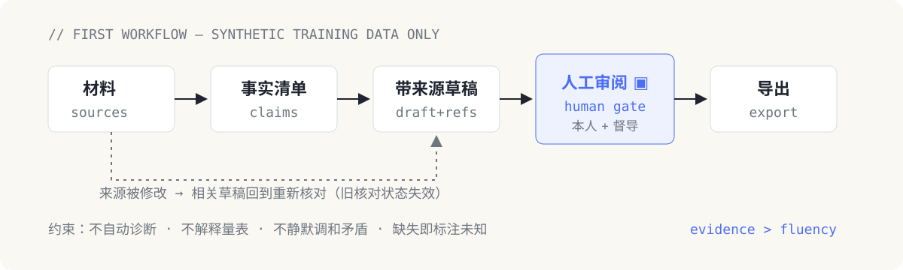

<!-- architect-team:readme-theme=mono -->

  

**简体中文** | [English](README.en.md) | [繁體中文](README.md)

  

psychtool 是一个帮助个人写报告的临床写作工作区，目标用户是没有技术背景的临床培训生。它解决的核心问题：**如何在把分散材料整理成报告草稿的同时，保留谁在什么场合、什么时间、以什么确定性说了什么**——而不是先生成流畅文本再回头补引用。

心理评估报告、临床个案报告、进展记录与学术论文都在长期范围内；当前优先临床写作，首个验证场景刻意收窄为**整理合成的青少年背景资料**：不做诊断、不解释量表、不做治疗决策。青少年与神经心理侧重是设计选择；机构 AI 政策尚未确认。

  

**核心应用已实现并可运行**：`psychtool` 命令行（`init` / `import` / `claims` / `draft` / `review` / `export` / `eval` / `judge` / `dash`）+ textual 仪表盘 + 彩色启动横幅，**66 项自动化测试通过**。**真实模型已接入**（linksub `deepseek-v4-pro`，OpenAI 兼容端点）并跑通真实 `eval`：单步生成干净（无编造、无跨案泄漏、无矛盾化解），朴素分步基线被硬门槛捕获跨案引用；桌面/网页界面与 PDF/OCR 导入推迟（见 ADR 0001、ticket 12）。

本仓库包含：需求与边界、官方隐私来源研究、实证证据矩阵、开发规格与实现票、两组原创合成训练材料，以及上述可运行的 CLI 应用。详细研究文档以简体中文为主。

  

已实现（CLI 命令面）：

  

  

- **OpenAlex 检索。** 四次查询共返回 **35 条去重候选记录**，注意事项见 [references/empirical-research.md](references/empirical-research.md)。
- **已核读研究。** **9 项研究**完成实质核读（4 项儿童／青少年评估、5 项 AI 临床文书）。其中一项研究观察到“先抽取事实再生成”的配置反而增加重大错误——本项目因此**不预设多步流程更安全**，评测将对比单步与分步方案。细节与访问边界见 [references/empirical-research.md](references/empirical-research.md)。
- **合成训练个案。** [fixtures/adolescent-background.json](fixtures/adolescent-background.json) 含 **2 例原创合成个案**，附来源段落定位，用于溯源与个案隔离检查。
- **来源保真变体。** [fixtures/source-fidelity-variants.json](fixtures/source-fidelity-variants.json) 保存 **3 组配对变体**（缺失 vs 否定、第三人归属、简洁性–遗漏），附期望行为。

以上文献启发设计判断，不能证明本项目已减少错误或提升效率；尚无任何模型输出性能结论。

  

| 步骤 | 文档 | 确立的内容 |
|---|---|---|
| 1 | [临床需求与设计约束](docs/clinical-requirements.md) | 使用者、范围、审核责任与隐私约束 |
| 3 | [实证研究入口](references/empirical-research.md) | 检索覆盖、已核读证据与访问限制 |
| 4 | [工作流规格草案](docs/first-workflow-spec.md) | 首个端到端行为与验收条件 |

更多资料入口：[HHS 来源记录](references/hhs-sources.md) · [技能与工具选型](docs/skills-and-tools.md) · [开发规格 SPEC 0001](docs/specs/0001-first-workflow-cli.md) · [架构决策 ADR](docs/adr/) · [实现票](.scratch/first-workflow/issues/)

  

- 当前材料均为合成、公开来源或开发者笔记，不含真实患者资料。
- 个案隔离、日志、临时文件、备份、网络请求与导出副本都是**待实现并待验证**的边界。
- 本地运行、加密或某项工具的通过结果，均不能单独证明 HIPAA 合规性。来源核查见 [references/privacy-research.md](references/privacy-research.md)，不构成法律意见。
- DSM 优先经学校授权入口人工查阅；APA 与 Pearson 的条款对 AI 使用有限制，阅读权限不等于应用入库权限。

  

1. 在真实模型上跑 `judge`（逐陈述语义支持率，独立 judge 槽位）。
2. 为学生做图形界面（桌面/网页，ADR 0001 推迟项）。
3. PDF/扫描件导入（本地 Indra OCR，见 [references/ocr-tooling.md](references/ocr-tooling.md)、ticket 12）。
4. 通过评测后再评估是否引入 Harness² 优化工作流，以及是否接入受许可的文献资源。

  

机构内部 AI 政策、使用者设备与偏好仍为未知；证据核读受访问条件限制，未完成全面的勘误清查；未附带开源许可证，**保留所有权利**。本文档结构以本地渲染为验证依据。
